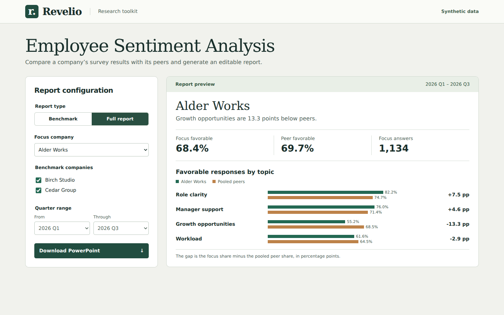
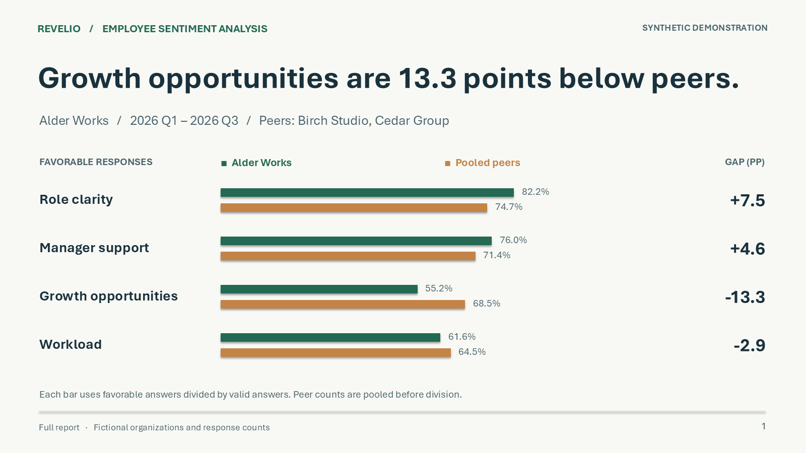

# Revelio · Employee Sentiment Analysis

Revelio is a local research toolkit for comparing employee survey responses across companies. Choose a focus company, a peer group, and a quarter range. The browser previews the comparison, and the same inputs generate an editable PowerPoint report.

This public edition recreates the historical prototype’s company selection, benchmarking, and report-generation workflow with fictional organizations, synthetic response counts, and newly written presentation layouts. It runs offline after installation.

## Configure a comparison



The interface opens with **Alder Works** as the focus company, **Birch Studio** and **Cedar Group** as peers, and all three quarters selected. Changing the company, peer selection, or time range recalculates the preview. Select **Download PowerPoint** to generate a deck from the current settings.

| Report type | What it contains |
| --- | --- |
| Benchmark | A topic-by-topic comparison and a slide explaining the response base and calculation. |
| Full report | The benchmark comparison, a quarterly trend slide, and the calculation notes. |

## Read the Employee Sentiment Analysis output



[Download the example PowerPoint](examples/employee-sentiment-analysis.pptx) · [Inspect the synthetic input CSV](examples/synthetic-responses.csv)

In the example, **159 of 288** growth-opportunity answers at Alder Works are favorable (55.2%). Across the two peers, **518 of 756** are favorable (68.5%). The difference is **−13.3 percentage points**, the largest absolute gap among the four topics. Across all topics, the focus company contributed 1,134 answers. That count measures answers across questions and quarters, so it cannot be used as a headcount.

The fixture contains one row per company, quarter, and topic. The report sums favorable and valid answers separately before dividing. A peer with more answers therefore carries more weight. It calculates differences before rounding and displays them to one decimal place. The example illustrates descriptive comparisons and supplies no evidence about real employers.

## Run locally

Use Python 3.10 or later. From the repository root on macOS or Linux:

```sh
python3 -m venv .venv
. .venv/bin/activate
python -m pip install -r requirements.txt
python server.py
```

On Windows PowerShell, create the environment with `py -m venv .venv`, then run `.\.venv\Scripts\python.exe -m pip install -r requirements.txt` and `.\.venv\Scripts\python.exe server.py`.

Open **http://127.0.0.1:8000**. To use a different local port, pass `--port 8080`. The bundled data supplies every calculation. No account, API key, or provider connection is required.

## Verify or adapt the example

Run `python -m unittest -v` in the activated environment. The tests reconcile counts against the fixture, exercise both report types, inspect the generated slide text, and check invalid configurations.

- [Analysis model](reporting/model.py) validates the selection, pools the answers, and computes the topical and quarterly results.
- [Presentation generator](reporting/deck.py) writes editable PowerPoint text and bars from those same results.
- [Local server](server.py) serves the browser interface and produces a deck on request.
- [Interface](static/index.html) and [interaction code](static/app.js) handle configuration, preview, and download.
